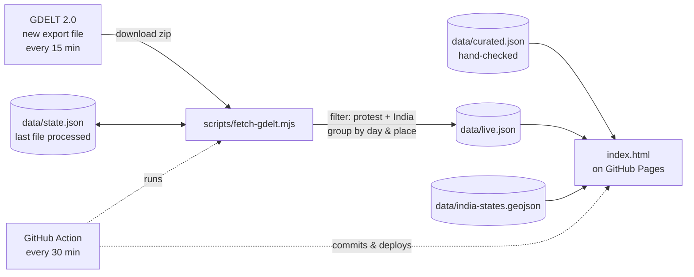

# India Protest Map

A live, open-source map of protests across India. Every pin links to the news reporting behind it.

The map combines two layers:

| Layer | Where it comes from | How it's updated | Shown as |
|---|---|---|---|
| **Checked entries** | Researched by hand from news reports | Edited in `data/curated.json` | ● Circles |
| **News detections** | The [GDELT 2.0 Event Database](https://www.gdeltproject.org/) | Automatically, every 30 minutes | ◆ Diamonds |

The whole project is static. A GitHub Action fetches the data and GitHub Pages hosts the site. There's no server, no database and no API key, and it costs nothing to run.

---

## Contents

- [Features](#features)
- [How it works](#how-it-works)
- [Project structure](#project-structure)
- [Quick start: deploy to GitHub Pages](#quick-start-deploy-to-github-pages)
- [Running locally](#running-locally)
- [The live data pipeline](#the-live-data-pipeline)
- [Data formats](#data-formats)
- [The frontend](#the-frontend)
- [Adding and reviewing protests](#adding-and-reviewing-protests)
- [Configuration reference](#configuration-reference)
- [Methodology and editorial approach](#methodology-and-editorial-approach)
- [Known limitations](#known-limitations)
- [Troubleshooting](#troubleshooting)
- [Ideas for what to build next](#ideas-for-what-to-build-next)
- [Credits and licence](#credits-and-licence)

---

## Features

- **Map of India.** Shows all states and union territories. You can pan and zoom (mouse, trackpad, touch or the +/− buttons).
- **Live news detections.** Protest events reported anywhere in India are pulled from GDELT every 30 minutes, then grouped by day and location.
- **Checked entries.** These are hand-researched protests with a summary, the authorities' response where reported, and source links.
- **Long-running movements.** Ongoing movements, such as the Ladakh statehood movement, stay on the map in every time range.
- **Filters:**
  - Time range: Today / 7 days / 30 days / all of 2026.
  - Issue: click the legend chips.
  - News detections on or off.
  - Include single-outlet reports.
- **Linked map and list.** Click a pin to open its entry in the list. Click an entry to zoom the map to it.
- **Freshness indicator.** Shows when the live data last updated, and warns if updates seem to have stopped.
- **Auto-refresh.** An open page reloads the live data every 5 minutes.
- **Reader suggestions.** The "Suggest a protest" link opens a GitHub issue form.
- **Responsive and accessible.** Works on phones, supports keyboard navigation and light/dark mode, and respects reduced motion.

---

## How it works



1. **GitHub Actions** runs `.github/workflows/update.yml` on a 30-minute schedule. It also runs on every push to `main` and whenever you trigger it manually.
2. The workflow runs `scripts/fetch-gdelt.mjs`, which:
   - downloads every GDELT export file published since the last run,
   - keeps protests located in India,
   - merges them into `data/live.json`.
3. The workflow commits the updated `data/live.json` and `data/state.json` back to the repo, so the next run knows where it left off.
4. It copies `index.html` and `data/` into `_site/` and deploys that folder to **GitHub Pages**.
5. In the browser, `index.html` loads three files: the map shapes, the checked entries and the live detections. It draws them with D3.

---

## Project structure

```
india-protest-map/
├── index.html                      # The whole frontend (HTML + CSS + JS, uses D3 from cdnjs)
├── data/
│   ├── curated.json                # Hand-checked protests (edit this)
│   ├── live.json                   # Auto-generated news detections (don't edit)
│   ├── state.json                  # Pipeline bookmark: last GDELT file processed (don't edit)
│   └── india-states.geojson        # Simplified state/UT boundaries
├── scripts/
│   └── fetch-gdelt.mjs             # The data pipeline
├── .github/
│   ├── workflows/update.yml        # Schedule, commit and deploy
│   └── ISSUE_TEMPLATE/
│       └── report-protest.yml      # "Suggest a protest" form
├── package.json                    # One dependency: fflate (for unzipping)
└── README.md
```

---

## Quick start: deploy to GitHub Pages

1. **Create a repo** on GitHub, e.g. `india-protest-map`, and push this folder:
   ```bash
   cd india-protest-map
   git init
   git add .
   git commit -m "Initial commit"
   git branch -M main
   git remote add origin https://github.com/<your-username>/india-protest-map.git
   git push -u origin main
   ```
2. **Turn on Pages.** In the repo, go to **Settings → Pages**. Under **Build and deployment → Source**, choose **GitHub Actions**.
3. **Allow the workflow to push.** Go to **Settings → Actions → General → Workflow permissions** and select **Read and write permissions**. This lets the bot commit `live.json`.
4. **Run the first update with a backfill.** Go to **Actions → Update live protest data → Run workflow** and set `backfill_hours` to `168`. This loads the past 7 days instead of the default 24 hours.
5. **Open the site** at `https://<your-username>.github.io/india-protest-map/`.

From then on it updates itself. GitHub's scheduler can delay runs by a few minutes, or longer at busy times. That's normal.

> The push in step 1 also triggers a run. That first run may fail if Pages isn't set up yet. Re-run it after step 3.

---

## Running locally

Requires **Node.js 20+**, which has a built-in `fetch`.

```bash
npm install          # installs fflate
npm run update       # fetches the last 24h of GDELT data into data/live.json
npm run dev          # serves the folder at http://localhost:3000
```

The page loads its data with `fetch()`. Browsers block that on `file://` URLs, so always open it through a local server. Any static server works, e.g. `python3 -m http.server`.

To fetch a whole week locally:

```bash
BACKFILL_HOURS=168 MAX_FILES=672 npm run update
```

To start the pipeline from scratch, reset the bookmark and the data:

```bash
echo '{"lastStamp":null}' > data/state.json
echo '{"generatedAt":null,"clusters":[]}' > data/live.json
```

---

## The live data pipeline

### What GDELT is

The [GDELT Project](https://www.gdeltproject.org/) monitors news worldwide, in many languages, and turns stories into structured "events". It codes each event with:

- **who** did **what** to **whom**, using the [CAMEO](https://parusanalytics.com/eventdata/cameo.dir/CAMEO.Manual.1.1b3.pdf) codebook,
- **where** it happened (place name, latitude, longitude),
- the **source URL** of the article.

A new export file is published every 15 minutes at `http://data.gdeltproject.org/gdeltv2/YYYYMMDDHHMMSS.export.CSV.zip`. The newest one is listed in `lastupdate.txt`.

### What the script does, step by step

`scripts/fetch-gdelt.mjs`:

1. **Loads its saved state.** It reads `data/live.json` (existing groups) and `data/state.json` (the timestamp of the last file it processed).
2. **Finds new files.** It reads GDELT's `lastupdate.txt` and lists every 15-minute timestamp between the bookmark and the latest file.
   - The list is capped at `MAX_FILES` per run.
   - On a fresh start it goes back `BACKFILL_HOURS`.
3. **Downloads and unzips each file** with `fflate`. Each file is tab-separated with 61 columns per row. Missing files (GDELT occasionally skips a slot) are logged and skipped.
4. **Filters rows.** A row is kept only if all of these hold:

   | Check | Column | Rule |
   |---|---|---|
   | It's a protest | `EventRootCode` (28) | equals `14` |
   | It happened in India | `ActionGeo_CountryCode` (53) | equals `IN` (FIPS code) |
   | It has a useful location | `ActionGeo_Type` (51) | `2` or higher (state, city or landmark; the bare country centroid `1` is dropped) |
   | It has coordinates | `ActionGeo_Lat/Long` (56/57) | both are numbers |
   | It's recent | `SQLDATE` (1) | within the last `WINDOW_DAYS` days |

5. **Groups rows** by `event date + latitude/longitude rounded to 0.1°`, which is roughly an 11 km cell. Each group accumulates:
   - the total `NumArticles`,
   - a count of each CAMEO event subtype,
   - up to 8 source URLs,
   - up to 40 distinct outlet domains,
   - first-seen and last-seen times.

   If a later row has a more precise location, the group's pin moves there.
6. **Labels each group:**
   - **Event type.** The most common CAMEO subtype:

     | Code | Meaning |
     |---|---|
     | 140 | Protest |
     | 141 | Demonstration or rally |
     | 142 | Hunger strike |
     | 143 | Strike or boycott |
     | 144 | Blockade or road obstruction |
     | 145 | Violent protest or riot |

   - **Headline.** GDELT has no headlines, so the script reads one from the article URL slug. For example, `/students-protest-against-election-commission/article123.ece` becomes "Students protest against election commission". If no slug works, the page shows "Protest reported in &lt;place&gt;".
   - **Issue.** Keyword matching on the URL slugs. The rules are in `MOVEMENT_RULES`:
     - `sir`: election commission, CEC, voter, electoral, SIR, ballot, EVM…
     - `exam`: exam, paper leak, NEET, SSC, UPSC, NTA, CUET…
     - `ladakh`: Ladakh, Leh, Kargil, sixth schedule
     - `labour`: worker, wage, strike, union, farmer, kisan, MSP, Anganwadi, ASHA…
     - anything else is `other`
7. **Prunes** groups older than `WINDOW_DAYS`, sorts newest first, caps the total at 3,000 groups, and writes `data/live.json`.
8. **Saves the bookmark** to `data/state.json`. This way no file is processed twice and no article is counted twice.

### The workflow

`.github/workflows/update.yml`:

- **Triggers:**
  - every 30 minutes (`cron: "*/30 * * * *"`),
  - on every push to `main`,
  - manually, with an optional `backfill_hours` input.
- Uses `concurrency: update-and-deploy`, so runs never overlap or race to push.
- Commits only if the data actually changed. It runs `git pull --rebase` first, so your own pushes in the meantime don't conflict.
- Deploys only `index.html` and `data/` to Pages. `node_modules` and scripts aren't published.
- Bot commits made with `GITHUB_TOKEN` don't trigger new workflow runs, so there is no infinite loop.

---

## Data formats

### `data/curated.json`, the checked entries

```json
{
  "updated": "2026-10-11",
  "events": [
    {
      "id": "e1",
      "movement": "sir",
      "date": "2026-10-10",
      "city": "New Delhi",
      "venue": "Jantar Mantar",
      "lat": 28.6271,
      "lng": 77.2166,
      "title": "Jantar Mantar 2.0 blocked, mass detentions",
      "summary": "What happened, in your own words.",
      "authorities": "Optional: what police, officials or the government said.",
      "sources": [{ "n": "CBC News", "u": "https://…" }],
      "ongoing": false
    }
  ]
}
```

| Field | Required | Notes |
|---|---|---|
| `id` | yes | Unique. Use the next `eN`. |
| `movement` | yes | `sir`, `exam`, `labour`, `ladakh` or `other`. Sets the colour and filter. |
| `date` | yes | `YYYY-MM-DD`. For ongoing movements, the start date. |
| `city`, `venue` | city yes, venue no | Shown in the list and tooltip. |
| `lat`, `lng` | yes | Decimal degrees. Get them from any map by right-clicking the spot. |
| `title` | yes | Short and factual. |
| `summary` | yes | Paraphrase the reporting; don't copy it. |
| `authorities` | no | Shown as a separate indented line. |
| `sources` | yes | At least one `{ n: name, u: url }`. |
| `ongoing` | no | `true` keeps it visible in every time range, with a dashed pin. |

### `data/live.json`, the news detections (generated)

```json
{
  "generatedAt": "2026-10-11T06:00:12.345Z",
  "source": "GDELT 2.0 Event Database",
  "windowDays": 7,
  "clusters": [
    {
      "id": "2026_10_11_28_6_77_2",
      "key": "2026-10-11|28.6|77.2",
      "date": "2026-10-11",
      "lat": 28.6, "lng": 77.2, "geoType": 4,
      "place": "New Delhi, Delhi", "adm1": "IN07",
      "articles": 18,
      "codes": { "141": 6 },
      "type": "141",
      "urls": ["https://…"],
      "domains": ["thehindu.com", "indianexpress.com"],
      "slugs": ["…"],
      "title": "Students protest against election commission sir deletions",
      "movement": "sir",
      "firstSeen": "20261011054500",
      "lastSeen": "20261011061500"
    }
  ]
}
```

### `data/state.json`

```json
{ "lastStamp": "20261011061500" }
```

This is the timestamp of the last GDELT file processed. Set it to `null` to start over.

### `data/india-states.geojson`

The boundaries of 37 states and UTs, from [datta07/INDIAN-SHAPEFILES](https://github.com/datta07/INDIAN-SHAPEFILES). They were simplified to about 4% of the original detail with [mapshaper](https://mapshaper.org/), which keeps the file around 40 KB. The polygon rings were rewound to the winding order D3 expects. Each feature has one property, `name`.

---

## The frontend

`index.html` is a single file with no build step. It uses:

- **D3 v7.8.5** from cdnjs, for map projection, drawing and zoom,
- **Anek Latin** (headlines) and **Hind** (body) from Google Fonts, both designed with Indian scripts in mind,
- plain JavaScript for everything else.

### Pins

| Pin | Meaning |
|---|---|
| ● solid circle, pulsing | Checked entry from the last 2 days |
| ● solid circle, faded | Older checked entry |
| ◌ dashed ring | Long-running movement |
| ◆ diamond | News detection. Bigger means more outlets; faded means a single outlet. |
| Colour | The issue: amber = voter rolls / EC, blue = exam leaks, teal = workers & farmers, purple = Ladakh, grey = other |

Pins at nearly the same spot are nudged apart in a small spiral so they don't hide each other. Pins shrink slightly as you zoom in, so dense cities stay readable.

### Behaviour

- **Time ranges** are based on the viewer's current date. Ongoing movements always show.
- **Single-outlet detections** are hidden by default. Groups covered by one outlet are the noisiest part of GDELT.
- The list is sorted newest first. Checked entries come before detections on the same day, and ongoing movements are at the end. It shows at most 400 items.
- `data/live.json` is re-fetched every 5 minutes, with cache-busting.
- The status line goes grey and warns if the data is more than 3 hours old.
- On `*.github.io`, the **Suggest a protest** link works out your repo from the URL. On a custom domain, set `REPO_OVERRIDE` at the top of the script, e.g. `"yourname/india-protest-map"`.

### Customising

- **Issues and colours.** Edit `MOVEMENTS` in `index.html`, the CSS variables `--m-*`, and `MOVEMENT_RULES` in the fetch script. Keep the keys the same in all three places.
- **Refresh rate.** Change `LIVE_REFRESH_MIN` in `index.html`.
- **Copy.** The title, subtitle and footer text are plain HTML near the top of `<body>`.

---

## Adding and reviewing protests

There are three ways a protest gets onto the map:

1. **Automatically.** GDELT picks up news coverage, and it appears as a diamond within about 30–60 minutes of being indexed.
2. **Reader suggestions.** Readers use the **Suggest a protest** form. Each suggestion becomes a GitHub issue labelled `protest-report`, with headline, place, date, issue, summary and source link.
3. **Checked entries.** You add an object to `data/curated.json` and push. The site redeploys within a couple of minutes.

A sensible review routine:

- Check the `protest-report` issues.
- Open the source and confirm the date and place.
- Write a short summary in your own words.
- Add the entry to `curated.json`, then close the issue with a link to the commit.

For a big detection (many outlets) that deserves context, add a checked entry for it. The checked entry gets the summary, the authorities' response and the better sources.

---

## Configuration reference

### Fetch script (environment variables)

| Variable | Default | What it does |
|---|---|---|
| `WINDOW_DAYS` | `7` | How many days of detections to keep in `live.json` |
| `MAX_FILES` | `96` (24h) | Max 15-minute GDELT files processed per run |
| `BACKFILL_HOURS` | `24` | On a fresh start (no bookmark), how far back to fetch |
| `GDELT_BASE` | `http://data.gdeltproject.org/gdeltv2/` | Download location. Override it to test against a local mirror. |

### Workflow

| Setting | Where | Default |
|---|---|---|
| Schedule | `on.schedule.cron` in `update.yml` | every 30 minutes |
| Manual backfill | "Run workflow" → `backfill_hours` | 24. Use 168 for a week. A manual run also raises `MAX_FILES` to 672. |

### Frontend

| Constant | Default | What it does |
|---|---|---|
| `REPO_OVERRIDE` | `""` | `owner/repo` for the suggestion link on custom domains |
| `LIVE_REFRESH_MIN` | `5` | How often an open page reloads `live.json` |

---

## Methodology and editorial approach

The map is meant to be a reliable record that people of any political view can check for themselves.

- **Every entry has a source.** Nothing goes on the map without a link a reader can open.
- **Paraphrase, don't copy.** Summaries are written in our own words and kept short.
- **Report responses alongside claims.** Where police, officials, the Election Commission or the government responded (permission refused, allegations rejected, internet shutdowns ordered), the entry says so in its own line.
- **Separate checked from automatic.** Detections are always labelled "Auto-detected" and drawn as a different shape. The footer explains that they can be wrong.
- **Neutral titles.** Titles describe what happened ("Opposition march for CEC's resignation"), not whether it was justified.
- **Mark unconfirmed things as such.** Announced events that weren't confirmed as held are labelled "(announced)".

---

## Known limitations

- **GDELT is automated and noisy:**
  - The same protest can appear as several groups.
  - A story datelined in Delhi about a protest elsewhere can be pinned to Delhi.
  - Coverage of past events can slip through.
  - Headlines guessed from URL slugs are sometimes clumsy.
  - The single-outlet filter and source links help, but they don't fix any of this.
- **Coverage is uneven.** GDELT leans on English-language and online outlets. Rural and regional-language protests are under-counted.
- **Issue tags are keyword guesses** from URLs. Many real protests land in "Other issues".
- **There are no crowd or detention numbers** for detections. GDELT doesn't provide them.
- **GitHub's scheduler isn't exact.** Runs can be delayed. GitHub also **pauses scheduled workflows in public repos after 60 days with no repository activity**. If updates stop, re-enable the workflow in the Actions tab, or push any commit.
- **Repo size grows slowly**, because `live.json` is committed on every change. If it ever matters, squash the history of the data files or move the data to a separate branch.

---

## Troubleshooting

| Symptom | Likely cause and fix |
|---|---|
| "Live news data hasn't been generated yet" | The workflow hasn't run successfully. Go to Actions → Update live protest data → Run workflow, then check the log. |
| Workflow fails at **Commit updated data** with a 403 | Turn on **Read and write permissions** under Settings → Actions → General. |
| Workflow fails at **deploy-pages** | Set Settings → Pages → Source to **GitHub Actions**, then re-run. |
| Log shows `Skipping … 404` lines | Normal. GDELT occasionally skips a 15-minute slot. |
| `Could not read GDELT lastupdate.txt` | GDELT is down or changed its format. The next run will retry. If it persists, open `http://data.gdeltproject.org/gdeltv2/lastupdate.txt` in a browser and compare. |
| Status says updates may be paused | Check the Actions tab for failed or disabled runs (see the 60-day note above). |
| Map is blank locally | You opened `index.html` directly. Serve it with `npm run dev`. |
| Very few detections | Tick "Include single-outlet reports", widen the time range, or do a 168-hour backfill. |
| "Suggest a protest" link missing | You're on a custom domain or localhost. Set `REPO_OVERRIDE`. |

---

## Ideas for what to build next

- **Better headlines.** Fetch each source page's `<title>` in the pipeline, or use GDELT's DOC API, instead of guessing from the URL.
- **Smarter issue tagging.** Run the article titles through an LLM in the workflow to classify the issue and write a one-line summary. Store the result so it runs once per group.
- **Merge duplicates.** Merge groups in the same district on the same day, using the `adm1` code and distance.
- **Add a second source.** Use ACLED (weekly, human-coded, needs a free API key) as a more reliable layer.
- **Archive and timeline.** Keep monthly snapshots of `live.json` and add a time slider showing how protests spread.
- **Per-state pages.** Add shareable links like `?state=Bihar`, plus counts and a mini chart for each state.
- **Alerts.** Post to a Telegram or X bot when a new group passes, say, five outlets.

---

## Credits and licence

- **Event data:** [The GDELT Project](https://www.gdeltproject.org/). GDELT data is free to use; please credit "The GDELT Project".
- **Boundaries:** [datta07/INDIAN-SHAPEFILES](https://github.com/datta07/INDIAN-SHAPEFILES), simplified with [mapshaper](https://github.com/mbloch/mapshaper).
- **Libraries:** [D3](https://d3js.org/) (ISC), [fflate](https://github.com/101arrowz/fflate) (MIT).
- **Fonts:** [Anek Latin](https://fonts.google.com/specimen/Anek+Latin) and [Hind](https://fonts.google.com/specimen/Hind) (SIL Open Font License).
- **Checked entries** are summaries of reporting by the outlets linked in each entry.

No licence file is included yet. Add one before inviting contributions. MIT is a common choice for the code, and CC BY 4.0 for `curated.json`.
